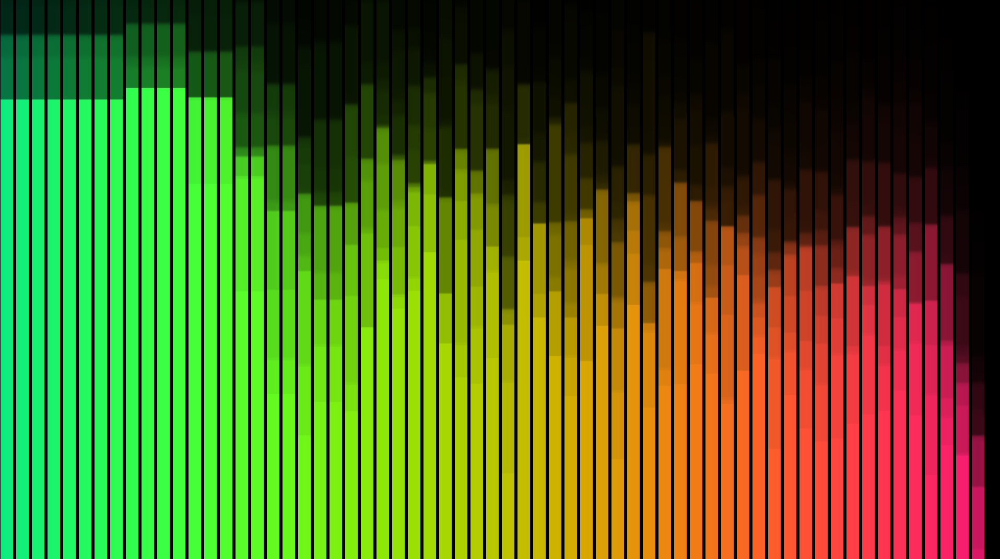

# Spectrum for Popamp



A [Popamp](https://github.com/popamp/popamp) visualizer plug-in: bars of
the sound's spectrum, each leaving a trail that rises and fades. The
colours drift slowly, so the picture keeps changing on a monitor left
running.

It is also the example of a visual plug-in. `src/lib.rs` is the two calls,
`api_version` and `scene`, described in
[popamp-plugin-api](https://github.com/popamp/popamp-plugin-api);
the `.wgsl` files are the shaders. The plug-in says what to draw and the
player makes every GPU call, so it needs no permissions.

## Install

You need a Popamp built with visualizers: Popamp Plus, or
`cargo build --release --features visualizers`. Clone it into Popamp's
plug-ins folder:

```sh
git clone https://github.com/popamp/plugin-spectrum ~/.local/share/popamp/plugins/spectrum
```

The folder must be called `spectrum`, the plug-in's id. Then in Popamp:
Options > Plug-ins…, tick Spectrum and press OK. It opens from the
Visualization menu. F toggles full screen, Esc leaves it or closes the
window.

To update: `git pull` in that folder.

## Build

```sh
rustup target add wasm32-unknown-unknown   # once
./build.sh                                 # writes plugin.wasm
cargo test                                 # draws the real scene natively
```

The tests use the player's own renderer, so they check that the shaders
compile and what they draw. A machine with no GPU skips the drawing.

`plugin.wasm` is committed, so cloning the repository installs a working
plug-in; rebuild it with `./build.sh` whenever `src/` changes.

## License

MIT or Apache-2.0, at your option.
